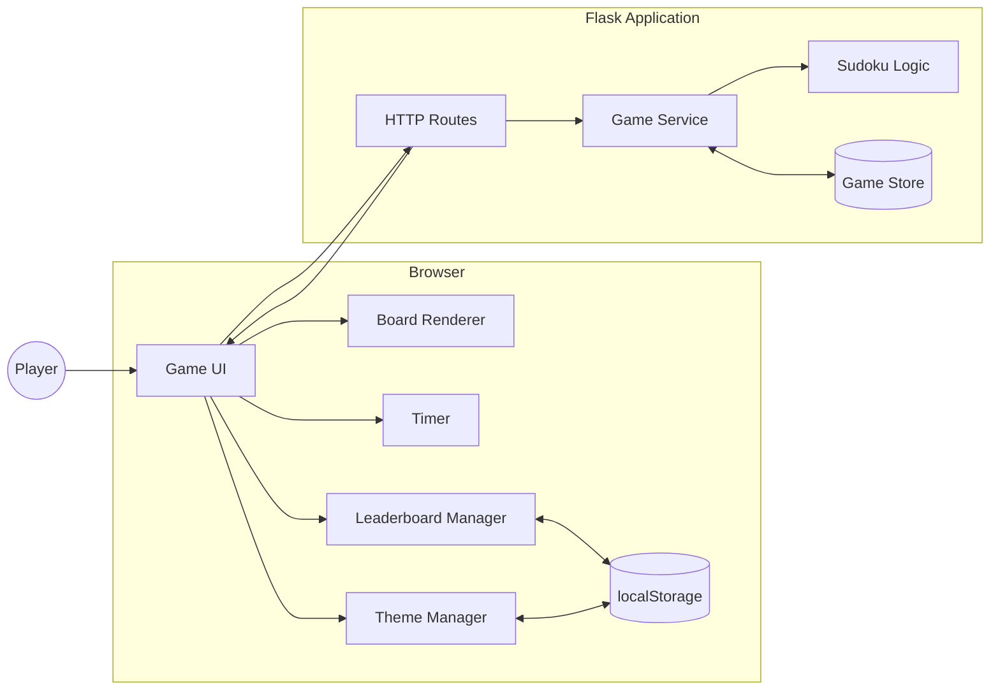
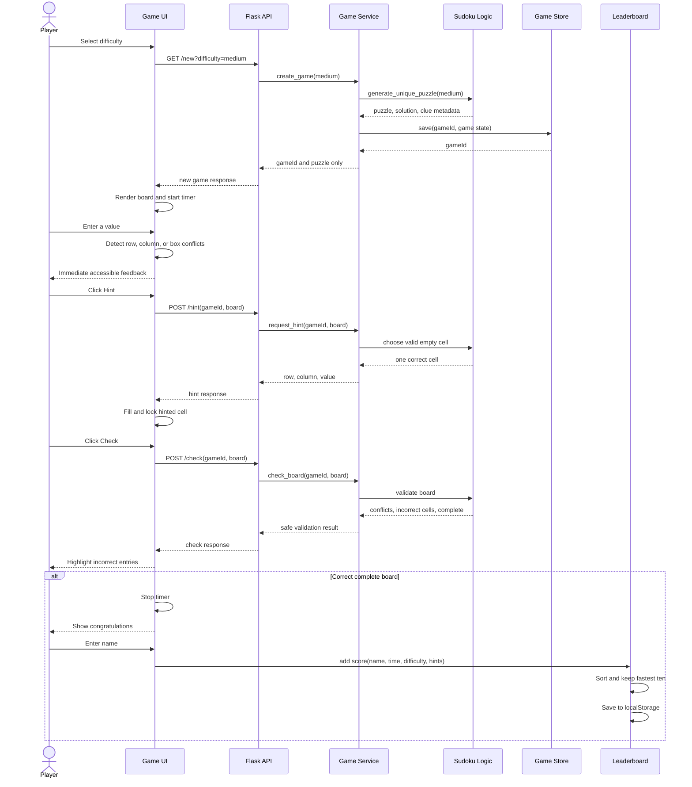
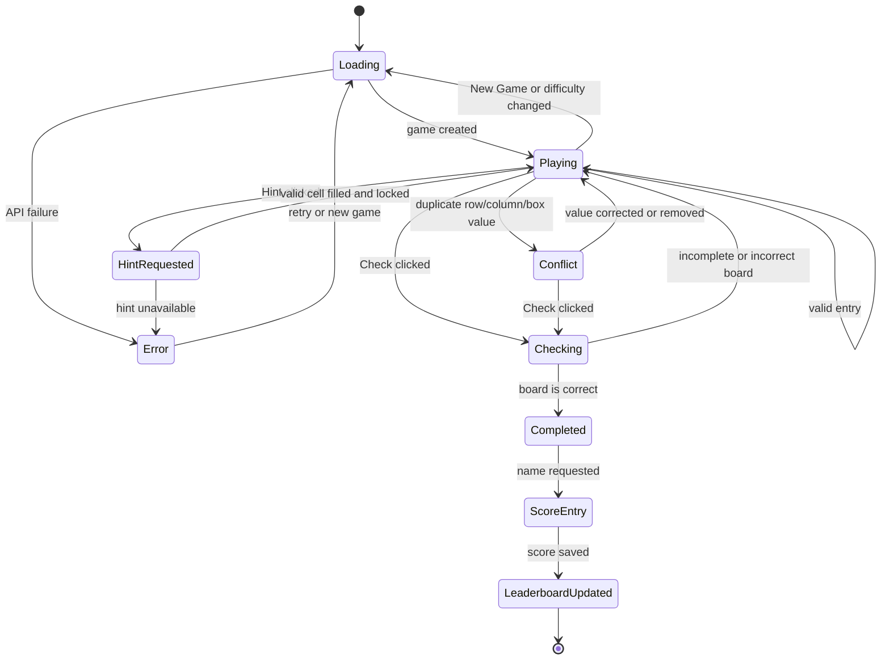
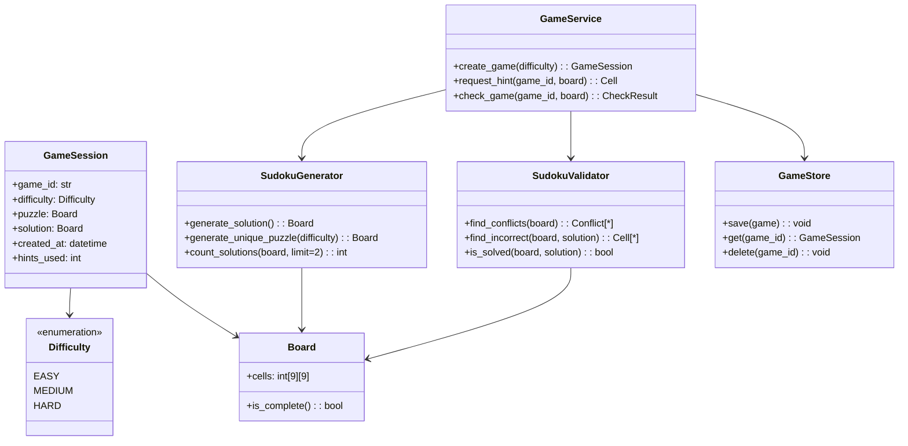

# Sudoku Game UML Views

These diagrams describe the target design for the implementation. They are intentionally technology-light: the exact Python module names and browser module names may evolve, but the responsibilities and boundaries should remain recognizable.

## 1. Component and deployment view

The browser owns presentation, timer display, theme preference, and the personal leaderboard. Flask owns puzzle validity, solution uniqueness, game state, hints, and authoritative completion checks.

## 2. New game, hint, check, and completion sequence

## 3. Game state view

## 4. Domain and service view

The solution may exist inside a server-side `GameSession`, but it must not be serialized into normal browser responses. The browser receives only the puzzle and safe validation or hint results.
